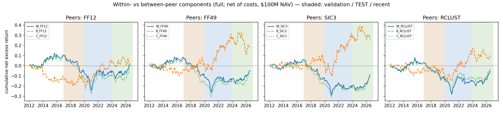

# Who Is Your Peer? Industry-Relative Multi-Theme Signals in a Beta-Neutral Long/Short Equity Book

*Research artifact, not investment advice. Built entirely on free data.*

**Question.** Vanguard's Quantitative Equity Group says in SEC filings that its five-theme stock model
(growth, quality, management decisions, sentiment, valuation) ranks stocks *relative to industry peers*,
and that "sector bets do not add value over the long term" (Form N-CSR, filed 2021-03-01). Its 2026 prospectus
commits only to *beta* neutrality. **Does the industry-bet part of such a composite actually earn nothing?
Does the definition of "peer" matter?**

**Approach.** We rebuilt a five-theme composite from as-first-reported SEC XBRL filings, with exact filing-date
availability, and split it into **within-industry** and **between-industry** components under four peer
definitions (FF12, FF49, SIC-3, return-correlation clusters). Each is traded as a beta-neutral long/short book with a
factor risk model, spread and square-root impact costs, and borrow fees. The hypotheses were **pre-registered and frozen
in git before the 2020–2023 test period was computed** (`research/preregistration.md`, commit `prereg: freeze`).

**Interactive version:** `docs/index.html`. Switch universe, peer definition, cost and momentum variants, the beta hedge
and the evaluation period; every statistic is recomputed in the browser from the backtest's monthly returns.
To host it free on GitHub Pages: repository *Settings → Pages → Deploy from branch → `/docs`*.
It also has three 3D views: an animated **industry landscape** (industries by sentiment × valuation, height = next-month
return, colour = the book's position), a **peer map** (1,000 stocks embedded by residual-return co-movement, showing how
statistical peer clusters cut across SIC sectors) and a **regime surface** (rolling Sharpe of every book over time).
Rebuild after new runs with `python scripts/build_3d_data.py && python scripts/build_showcase_data.py`.



## Main results (test period 2020–2023, 48 months, net of costs, $100M NAV)

| Hypothesis | Estimate | Verdict |
|---|---|---|
| H1: industry bets earn a positive premium | Between-FF49 Sharpe **0.68** [−0.31, 1.67]; Romano–Wolf p = 0.085 (4 schemes: 0.080–0.109) | Filing's claim **not contradicted** at 5%; the point estimate is positive and reverses in 2024–26 (−0.35) |
| H2: peer definition matters | SIC-3 − FF49 = −0.23 (Holm p 0.14); clusters − FF49 = +0.10 (p 0.60) | Not detected |
| H3: explicit industry neutrality matters | +0.01 (p 0.96) | Not detected |

* The reconstructed composite has **no reliable net alpha over 2012–2026** (Sharpe ≈ 0; gross ≈ 0.1). It is a value-tilted
  multi-factor (HML, RMW, UMD loadings) and lost heavily in the 2017–2019 value drawdown.
* **Unusual result:** the within- and between-industry components took turns: industry bets won in 2020–23, stock
  selection within industries won in 2024–26. Their correlation is low (0.07–0.37). Whether "sector bets add value"
  depends on which four years you look at, which a 14-year free-data sample cannot resolve.
* **Robustness:** the industry-bet book is the most stable result (test Sharpe 0.63–0.70 across 2× costs, a top-500
  universe and a no-momentum composite). In the top-500 universe it is significant (p = 0.004), which is suggestive evidence
  against the filing's claim in large caps, not the pre-registered primary test (`research/robustness.md`).
* **Post-hoc check (exploratory):** the industry-bet return is **not** industry momentum. But its "beta-neutral" book
  had a realised market beta of 0.19: daily-data betas understated true betas, so about a third of the 2020–23 return was
  leaked market exposure. Hedged with past data only, its Sharpe drops from 0.68 to 0.46. Among the 500 largest stocks there
  is no leak and the premium survives (0.68). Lesson: verify neutrality ex post, don't just constrain it ex ante
  (`research/posthoc_industry_momentum.md`).
* **Which theme drives it? (exploratory):** mainly the industry-level **sentiment** component (earnings surprises and
  momentum averaged by industry), plus **management decisions** in 2020–23. Industry-level **quality** was a consistent
  drag, and the leaked beta sat in the **valuation** component (`research/posthoc_theme_decomposition.md`).
* **Negative results are kept.** See `research/results.md` and `research/experiment_log.md` (every run, including the
  data bugs found and fixed).

## Honest limitations (details: `research/limitations.md`)
* **Survivorship bias:** free prices cover currently listed firms only. Measured coverage of the large firms that were
  listed at the time: ~54% (2012), 82% (2020), 93% (2023). Absolute Sharpe ratios are upward-biased; the study
  compares books on the same universe. A CRSP replication is the most valuable next step.
* Current (not historical) SIC codes; modelled (not measured) costs; flat borrow fee; theme variables are our
  reconstruction (Vanguard's are not disclosed); nothing here describes the Vanguard fund's performance.

## Reproduce
```bash
pip install -e ./qcore -e .                          # qcore: shared splits/metrics/bootstrap helpers (vendored)
echo "SEC_USER_AGENT=Your Name your@email" > .env     # SEC fair-access policy
python scripts/run.py download                        # ~3 GB SEC bulk + Yahoo + Ken French (free)
python scripts/run.py build                           # XBRL facts -> point-in-time characteristics -> monthly panel
python scripts/run.py calibrate                       # risk aversion on development months only
python scripts/run.py backtest --period development,validation --tag devval
export PREREG_HASH=$(python -c "from qcore.splits import file_hash; print(file_hash('research/preregistration.md'))")
python scripts/run.py backtest --period development,validation,test,recent --tag full_main
python -m peerrel.report results/runs/<run> --label test --start 2020-01 --end 2023-12
python scripts/survivorship_diagnostic.py
pytest -q
```
Yahoo data can change retroactively; each raw file's manifest records the retrieval time and sha256.

## Layout
```
src/peerrel/data/        SEC/Yahoo/French downloads, XBRL parsing (as-first-reported), company metadata
src/peerrel/features/    point-in-time fundamentals (YTD->quarter->TTM, filing-date availability), monthly panel
src/peerrel/signals/     peer groups, rank-Gaussian peer scores, themes, composite, within/between split
src/peerrel/risk.py      252-day beta + PCA risk model
src/peerrel/portfolio.py cvxpy beta-neutral optimiser with spread + sqrt-impact costs
src/peerrel/backtest.py  monthly walk-forward engine (signal at month-end close, trade next close)
src/peerrel/stats.py     HAC Sharpe-difference test, Romano-Wolf, spanning regression, deflated Sharpe
research/                methodology (verbatim SEC quotes), pre-registration, experiment log, results, limitations
tests/                   look-ahead shift test, point-in-time tests, scoring and statistics tests
paper_trading/           monthly simulated-live portfolios (see below)
```

## Paper trading (simulated, not real money)
After each month-end close, `python scripts/run.py paper --date YYYY-MM` writes the book weights to
`paper_trading/YYYY-MM/`. Commit them before the next trading day, then after the following month-end run
`paper-record` to log the realised outcome. The first valid portfolio is the September 2026 month-end
(generated after 2026-09-30).

## Sources
Vanguard Montgomery Funds N-CSR, acc. 0001104659-21-029823 · Vanguard Market Neutral Fund 497K, acc. 0001409957-26-000023 ·
Vanguard Fenway Funds N-CSR, acc. 0001104659-19-068932. Full citations: `research/institutional_methodology.md`,
`research/literature_review.md`.
