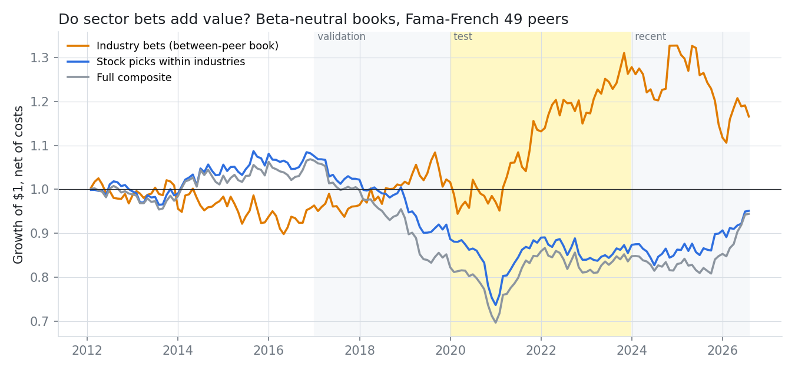
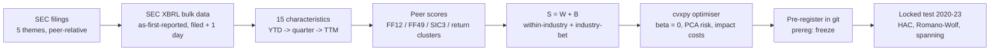
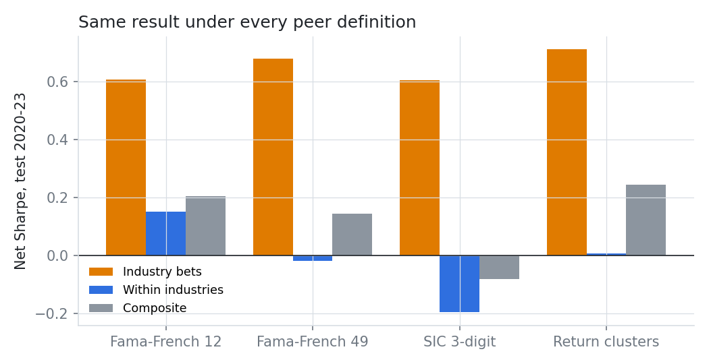
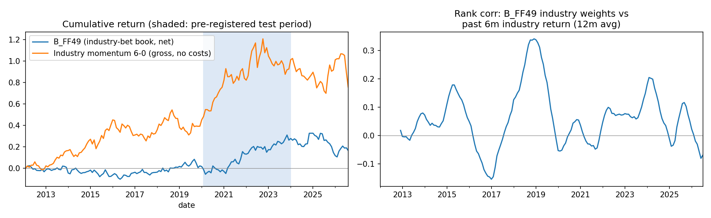

# Who Is Your Peer?

### An asset manager says in SEC filings that "sector bets do not add value over the long term". We rebuilt its five-theme stock model from free XBRL filings and tested the claim with a locked out-of-sample period.


-2ea44f)


> **TL;DR.** A quantitative equity group ranks stocks on five themes *relative to industry peers* and tells
> investors that sector bets add nothing. We rebuilt the composite from as-first-reported SEC XBRL data, split it
> into a **within-industry** book and an **industry-bet** book under four peer definitions, and traded each
> beta-neutral with a risk model, an optimiser and realistic costs. **In the locked 2020-23 test the industry-bet
> book earned a net Sharpe of 0.68 (95% CI -0.31 to 1.67)**, positive under all four peer definitions (0.60-0.71),
> but not significant at 5% after Romano-Wolf adjustment (p = 0.085). A post-hoc audit then found the "beta-neutral"
> book had leaked a 0.19 market beta; hedging it with past data cut the Sharpe to 0.46.



**Interactive explorer:** [`docs/index.html`](docs/index.html) (GitHub Pages ready) recomputes every statistic in the
browser and adds three 3D views: an industry landscape, a 1,000-stock peer map and a regime surface.

---

## 1. The research: what the filings say

| Filing | Quote (verbatim) |
|---|---|
| N-CSR, filed 2021-03-01 | the model evaluates stocks on growth, quality, management decisions, sentiment and valuation, **relative to industry peers**, and *"sector bets do not add value over the long term"* |
| 497K, 2026 | the market-neutral fund commits only to **beta** neutrality, not industry neutrality |

Every quote, accession number and what we take from it: [`research/institutional_methodology.md`](research/institutional_methodology.md).

## 2. The gap

| What is missing | Why it matters |
|---|---|
| **The claim has never been tested in the open.** It is a stated belief in a regulatory filing. | It drives a real design choice: rank within industries, ignore industry tilts. |
| **"Peer" is undefined.** SIC codes, Fama-French 12 or 49 industries and statistical return clusters can disagree sharply: 44% of our return clusters have no sector with a 60% majority. | If the answer depends on the peer definition, so does the model. |
| **Point-in-time fundamentals cost money.** Compustat/CRSP are standard; free SEC XBRL data is messy (YTD reporting, restatements, share-count scale errors). | Without exact filing dates, every fundamental backtest leaks the future. |
| **Neutrality is constrained, rarely verified.** Optimisers impose beta = 0 with estimated betas. | A book can be neutral on paper and not in reality. |

## 3. Our solution



| Step | What we did |
|---|---|
| Point-in-time data | as-first-reported XBRL values available from filing date + 1; YTD flows differenced to quarters; ×1000 share-scale errors detected and fixed |
| Signals | rank-Gaussian scores within peers for 15 characteristics in 5 themes; composite split exactly into within (W) and between (B) parts |
| Peers | Fama-French 12 and 49, SIC 3-digit, and Ward clusters on residual returns refitted each December |
| Portfolio | beta-neutral long/short, gross ≤ 200%, 1% name cap, ADV cap, spread + square-root impact, 25 bp borrow, $100M NAV |
| Inference | HAC Sharpe-difference tests, Romano-Wolf step-down, Holm, FF5+UMD spanning regressions, deflated Sharpe |

## 4. Results (locked test 2020-23, 48 months, net of costs)

| | Hypothesis | Result | Verdict |
|---|---|---|---|
| **H1** | Industry bets earn a positive premium (against the filing) | B_FF49 Sharpe **0.68** [-0.31, 1.67]; Romano-Wolf p = 0.085 (0.080-0.109 across schemes) | Filing's claim not contradicted at 5%; point estimate positive |
| **H2** | The peer definition matters | SIC3 - FF49 = -0.23 (Holm p 0.14); clusters - FF49 = +0.10 (p 0.60) | Not detected |
| **H3** | Explicit industry neutrality matters | +0.01 (p 0.96) | Not detected |



* **Robust:** test Sharpe 0.63-0.70 across 2× costs, a top-500 universe and a no-momentum composite; in the top 500
  it is significant (p = 0.004), labelled as a robustness check, not the primary test.
* **Turn-taking:** industry bets won in 2020-23, stock picking within industries won in 2024-26 (-0.35 for B).
* **The full composite has no reliable net alpha over 2012-26** (Sharpe ≈ 0): a value-tilted multi-factor that lost
  in the 2017-19 value drawdown.

## 5. What we learned (including post-hoc audits, labelled as such)

1. **Neutral on paper is not neutral.** The beta-neutral book had a realised market beta of 0.19 (t 3.9): about a
   third of its 2020-23 return was leaked market exposure. A past-data hedge cuts its Sharpe from 0.68 to 0.46; in the
   top 500 there is no leak and the premium survives (0.68).
2. **It is not industry momentum.** Spanning on a Moskowitz-Grinblatt industry-momentum factor leaves the alpha.
3. **Sentiment drives it.** Industry-level earnings surprises and momentum, plus management decisions in 2020-23;
   industry-level quality is a drag, and the leaked beta sits in the valuation theme.



## 6. How we kept it honest

* Hypotheses frozen in git (commit `prereg: freeze`, hash `3838565b5aca`) **before** the test period was computed;
  `qcore.splits.guard` refuses to load test months without the hash.
* Every run, including the data bugs found and fixed, is in [`research/experiment_log.md`](research/experiment_log.md).
* Look-ahead shift test, point-in-time tests, scoring and statistics tests in `tests/`.
* **Survivorship is measured, not ignored:** free prices cover currently listed firms only; coverage of the large
  firms listed at the time was 54% (2012), 82% (2020), 93% (2023). Absolute Sharpes are biased up; comparisons
  between books share the same universe.

## 7. Reproduce

```bash
pip install -e ./qcore -e .
echo "SEC_USER_AGENT=Your Name your@email" > .env     # SEC fair-access policy
python scripts/run.py download                        # ~3 GB SEC bulk + Yahoo + Ken French (free)
python scripts/run.py build
python scripts/run.py calibrate
python scripts/run.py backtest --period development,validation --tag devval
export PREREG_HASH=$(python -c "from qcore.splits import file_hash; print(file_hash('research/preregistration.md'))")
python scripts/run.py backtest --period development,validation,test,recent --tag full_main
python scripts/readme_figures.py
pytest -q
```

## 8. Repository map

```
src/peerrel/data/        SEC/Yahoo/French downloads, XBRL parsing (as-first-reported), company metadata
src/peerrel/features/    point-in-time fundamentals, monthly panel
src/peerrel/signals/     peer groups, rank-Gaussian scores, themes, composite, within/between split
src/peerrel/risk.py      252-day beta + PCA risk model
src/peerrel/portfolio.py cvxpy beta-neutral optimiser with spread + sqrt-impact costs
src/peerrel/backtest.py  monthly walk-forward engine (signal at month-end close, trade next close)
src/peerrel/stats.py     HAC Sharpe tests, Romano-Wolf, spanning, deflated Sharpe
research/                methodology, pre-registration, experiment log, results, robustness, post-hoc, paper.md
docs/                    interactive explorer with 3D views (GitHub Pages)
paper_trading/           monthly simulated-live portfolios (not real money)
```

**Limitations** ([full list](research/limitations.md)): survivorship (measured above); current SIC codes; modelled
costs; theme variables are our reconstruction; nothing here describes the manager's fund performance.

**Sources:** N-CSR acc. 0001104659-21-029823 · 497K acc. 0001409957-26-000023 · N-CSR acc. 0001104659-19-068932.
Literature: [`research/literature_review.md`](research/literature_review.md).

*Research artifact, not investment advice.*
